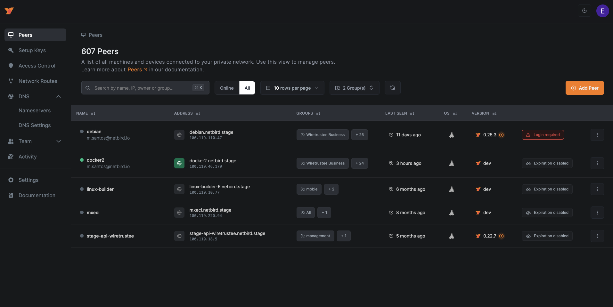
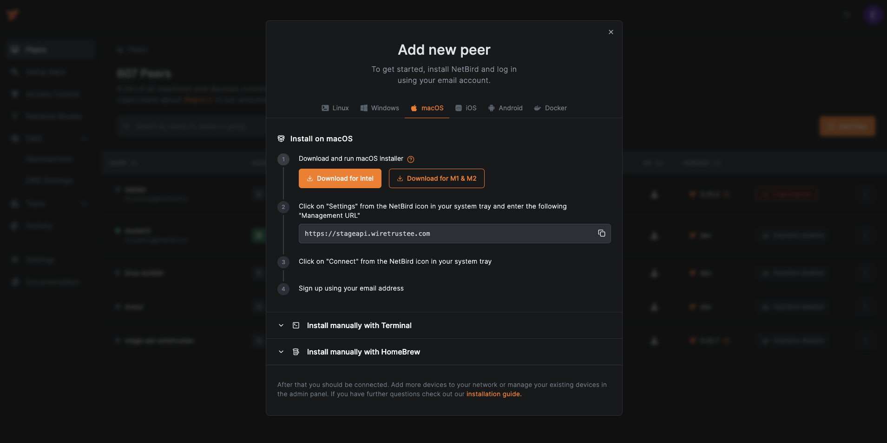

# WardenClyffe Dashboard

## Branding build boundaries

The dashboard uses `src/components/WardenClyffeLogo.tsx` and the cyan
`wardenclyffe` Tailwind palette. The embedded sign-in pages belong to the
combined service, not this dashboard image. Their shared header references
`idp/dex/web/themes/light/logo.svg`, `favicon.svg`, and `styles.css`, embedded
by `idp/dex/web/web.go`. Rebuild the combined image after changing these assets;
rebuilding only the dashboard does not update sign-in pages.

Go dependency replacement paths identify the repositories that actually publish
the pinned revisions; they are not product branding. Keep those sources reachable.
Renaming a replacement to a WardenClyffe fork requires publishing that fork and
its referenced revision first, otherwise the combined service cannot rebuild.

This project is the UI for WardenClyffe's Management service.

**Hosted version:** https://app.wardenclyffe.app/

See [WardenClyffe repo](https://github.com/shippin/wardenclyffe)

## Why?

The purpose of this project is simple - make it easy to manage VPN built with [WardenClyffe](https://github.com/shippin/wardenclyffe).
The dashboard makes it possible to:

- track the status of your peers
- remove peers
- manage Setup Keys (to authenticate new peers)
- list users
- define access controls

## Some Screenshots




## Technologies Used

- NextJS
- ReactJS
- Tailwind CSS
- [React Flow](https://reactflow.dev/) for the Control Center
- [Arktype](https://arktype.io/) for strict scripted-event and MCP payload contracts
- Auth0
- Nginx
- Docker
- Let's Encrypt

## UI ownership

Database-driven tooltips and popups belong to `src/modules/a2ui/`.
The independent conversation boundary belongs to `src/modules/chat/`.
MCP tool payload contracts and adapters belong to `src/modules/mcp/`.
Legacy machine-event contracts in `src/modules/scripted-events/` are not the
production UI event source and do not render chat messages.

Shared cards and buttons live in `src/components/canonical/`. Colocated native
controls live in `src/modules/a2ui/components/`, with fluid clamp tokens in
`src/app/globals.css`. See the event and boundary sections below for runtime
ownership, permissions, and remaining migration work.

## How to run

Disclaimer. We believe that proper user management system is not a trivial task and requires quite some effort to make it right. Therefore we decided to
use Auth0 service that covers all our needs (user management, social login, JWT for the management API).
Auth0 so far is the only 3rd party dependency that can't be really self-hosted.

1. Install [Docker](https://docs.docker.com/get-docker/)
2. Register [Auth0](https://auth0.com/) account
3. Running WardenClyffe UI Dashboard requires the following Auth0 environmental variables to be set (see docker command below):

   `AUTH0_DOMAIN` `AUTH0_CLIENT_ID` `AUTH0_AUDIENCE`

   To obtain these, please use [Auth0 React SDK Guide](https://auth0.com/docs/quickstart/spa/react) up until "Configure Allowed Web Origins"

4. WardenClyffe UI Dashboard uses WardenClyffe's Management Service HTTP API, so setting `WARDENCLYFFE_MGMT_API_ENDPOINT` is required. Most likely it will be `http://localhost:33071` if you are hosting Management API on the same server.
5. Run docker container without SSL (Let's Encrypt):

   ```shell
   docker run -d --name wardenclyffe-dashboard \
     --rm -p 80:80 -p 443:443 \
     -e AUTH0_DOMAIN=<SET YOUR AUTH DOMAIN> \
     -e AUTH0_CLIENT_ID=<SET YOUR CLIENT ID> \
     -e AUTH0_AUDIENCE=<SET YOUR AUDIENCE> \
     -e WARDENCLYFFE_MGMT_API_ENDPOINT=<SET YOUR MANAGEMENT API URL> \
     shippin/wardenclyffe/dashboard:main
   ```

6. Run docker container with SSL (Let's Encrypt):

   ```shell
   docker run -d --name wardenclyffe-dashboard \
     --rm -p 80:80 -p 443:443 \
     -e NGINX_SSL_PORT=443 \
     -e LETSENCRYPT_DOMAIN=<YOUR PUBLIC DOMAIN> \
     -e LETSENCRYPT_EMAIL=<YOUR EMAIL> \
     -e AUTH0_DOMAIN=<SET YOUR AUTH DOMAIN> \
     -e AUTH0_CLIENT_ID=<SET YOUR CLEITN ID> \
     -e AUTH0_AUDIENCE=<SET YOUR AUDIENCE> \
     -e WARDENCLYFFE_MGMT_API_ENDPOINT=<SET YOUR MANAGEMENT API URL> \
     shippin/wardenclyffe/dashboard:main
   ```

## How to run local development

1. Install [Node](https://nodejs.org/)
2. Create and update the `.local-config.json` file. This file should contain values to be replaced from `config.json`
3. Run `npm install` to install dependencies
4. Run `npm run dev` to start the development server

Open [http://localhost:3000](http://localhost:3000) with your browser to see the result.

You can start editing by modifying the code inside `src/..`  
The page auto-updates as you edit the file.

## How to migrate from old dashboard (v1)

The new dashboard comes with a new docker image `shippin/wardenclyffe/dashboard:main`.  
To migrate from the old dashboard (v1) `wiretrustee/dashboard:main` to the new one, please follow the steps below.

1. Stop the dashboard container `docker compose down dashboard`
2. Replace the docker image name in your `docker-compose.yml` with `shippin/wardenclyffe/dashboard:main`
3. Recreate the dashboard container `docker compose up -d --force-recreate dashboard`
### Database-driven canonical UI events

`src/modules/a2ui/` is the internal declarative UI library, not an implementation
of an external A2UI protocol. Its contracts, runtime, data adapter, admin controls,
and colocated input/textarea/tooltip/popup components have separate ownership.
Existing `Input` and `Textarea` imports forward to the canonical implementations,
preserving existing props, controlled values, refs, and password behavior.

The authenticated `/ui-events` Studio combines a live control inventory, real
input test surfaces, and an account-scoped event editor. Definitions are fetched
from management `/api/ui-events`, validated with ArkType, and refreshed on focus
and every 30 seconds. A failed fetch or invalid definition disables event
delivery and surfaces an error; no browser-local fixture substitutes for it.

Each definition names an exact route, stable target, native trigger, tooltip or
popup presentation, priority, and source/signal provenance. Hover tooltips also
respond to keyboard focus. Click/tap, focus, and explicit manual dispatch use
the same dispatcher. Database text is rendered as text, never executable code
or HTML. No UI event submits a form or calls a tool on its own.

Give components an explicit `eventTarget="ui.<surface>.<field>"`, or native
elements `data-ui-target`. Existing `id`/`name` fields are discovered as
`<tag>.<id-or-name>`. The registry includes mounted native controls and reports
missing names, missing stable targets, and duplicate targets. Missing/duplicate
targets cannot dispatch events. Inspector controls are excluded from their own
inventory to prevent recursive growth. Field values are never read or stored.

All mounted controls are inventoried; this does **not** mean every existing
screen has canonical IDs, accessible labels, or authored database help content.
The Studio exposes that debt rather than manufacturing targets or claiming a
completed application-wide migration. Sign-in and setup do not fetch private
account event definitions.

Example test path: create a tooltip for route `/ui-events`, target
`ui.gallery.name`, trigger `hover`, save it, and hover/focus the Name input.
Create a popup for `ui.gallery.action` with trigger `click`; clicking the real
button opens the accessible popup. Neither experience requires Playwright in
the application runtime. Playwright remains a test tool only.

Verify persistence by reloading after saving. Updating the content must change
the rendered event, disabling it must stop dispatch, and deleting it must remain
effective after another reload. Check keyboard focus, Escape dismissal, popup
focus restoration, unchanged input values, and viewport containment at 320px.
Remove temporary verification definitions when finished.

### Separate chat, event, and MCP boundaries

- `src/modules/chat/`: conversation contracts and browser-local preferences,
  `components/` for the bottom-right chat boundary, and `admin/` for chat controls.
  It does not import event or MCP runtime code.
- `src/modules/scripted-events/`: legacy knowledge-drop and machine-event
  contracts, lane classification, and parsers. Its local preview is no longer
  mounted as the production UI event source. Canonical UI rendering and persisted
  event editing now belong to `a2ui/`; neither feeds chat automatically.
- `src/modules/mcp/`: `contracts/` owns tool payloads, `adapters/` validates results
  for explicit consumption by the event layer, and `admin/` owns connection status.
  Tool payload contracts are not MCP JSON-RPC transport implementations.

Configuration exposes independent `?tab=chat`, `?tab=scripted-events`, and `?tab=mcp`
sections. Configuration access uses `agent_network.settings` permissions.
The Studio uses settings read/update permissions; management enforces
`Settings.Update` for UI-event mutations.
Chat visibility remains a browser-local preference; UI event definitions are
management-persisted records. MCP creation, credentials, execution, and auditing
are unavailable until a server-side connection manager exists.

Chat has no configured backend: the composer and send button are disabled.
No fake assistant replies, event-to-message conversion, or automatic tool calls
are generated. Close/reopen, minimize/expand, top docking, and Escape work within
the dashboard chat boundary. Native UI events render outside it.

The embedded Dex sign-in chat uses separate assets under
`idp/dex/web/themes/light/chat/`, compiled into the combined service. It does not
receive authenticated state or dashboard preferences across origins. Rebuild
both dashboard and combined images to update both surfaces.
